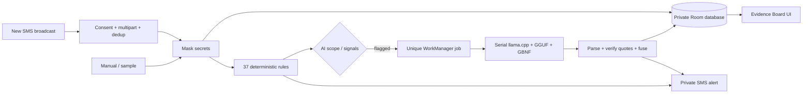

# SALAG TRACE

**Suri bago pindot.** A native Android tool that screens new carrier SMS, runs a small AI model on the phone, and shows where its evidence appears in the masked message. Filipino, Taglish, and English messages are supported. This is a hackathon prototype: AI conclusions can be wrong, and physical-device reliability remains unverified.

## What works

- Consent-based new-SMS monitoring without reading inbox history or becoming the default SMS app.
- Fast rules first, then real llama.cpp inference for flagged messages (or all messages by choice).
- OTP/password/card/account masking before persistence and inference; exact/partial quote verification, numbered evidence traces and conservative disagreement handling.
- Private alerts and detail navigation, dashboard, filtered history, manual paste checker, three-step onboarding, Filipino/English UI, dark/light appearance.
- Seven/30-day retention, delete/disable controls, model import with progress, model picker and a self-test with actual token throughput and load/total times.

Rules are labeled **Rule check**. Completed inference carries **On-device AI**, model name and measured time. Missing, failed, canceled or timed-out AI retains a rule result. A quote matching the message does not prove the model's reasoning is correct. Advice is static and uses official-channel guidance rather than generated hotline numbers.

## Build

Requirements: Android Studio/JBR 21, SDK 36, NDK 28.2.13676358, CMake 3.22.1; an arm64 Android phone/emulator running Android 10+ with at least 6 GB RAM and roughly 3 GB free storage. The APK supports arm64 CPUs with ARMv8.2 dot-product instructions only. All dependency versions and llama.cpp are pinned.

```sh
git clone --recurse-submodules <your-repository-url>
cd bryl-lim-hackathon
# If already cloned:
git submodule update --init --recursive
source scripts/env.sh
./gradlew assembleDebug
./gradlew testDebugUnitTest
./gradlew assembleRelease
```

`scripts/env.sh` finds Android Studio's JBR and the standard Android SDK on macOS; set JAVA_HOME and ANDROID_HOME for other hosts. SDK paths in local.properties are intentionally not committed. Initial Gradle dependencies and build tools require internet on the development host; the installed app has **no INTERNET or ACCESS_NETWORK_STATE permission**.

Release output: `app/build/outputs/apk/release/app-release.apk`. This sideload build is signed with the local Android debug key as permitted by the plan; it is not a Play Store distribution. Fresh build hosts generate a different key and may need to uninstall a previously installed APK before installing their own.

## Install and provision a model

```sh
source scripts/env.sh
adb install -r app/build/outputs/apk/debug/app-debug.apk
adb shell am start -n ph.salagtrace/.MainActivity
# Downloads to the DEVELOPMENT HOST, verifies pinned SHA-256:
./scripts/download_models.sh
./scripts/push_model.sh models/qwen2.5-1.5b-instruct-q4_k_m.gguf
```

Open the app once before pushing so Android creates the correctly owned model directory. Reopen or choose Settings → Rescan. Alternatively, copy a GGUF to your phone using a computer/browser, then Settings → Import model file: Android's file picker copies it into app-private storage with progress. The app never downloads models. Allow space for the source and imported copy. A header/size check detects obvious invalid files; self-test performs a real native load and can reject otherwise corrupt models.

Default: [Qwen2.5 1.5B Instruct GGUF Q4_K_M](https://huggingface.co/Qwen/Qwen2.5-1.5B-Instruct-GGUF), Apache 2.0, approximately 1.12 GB. Exact revisions/checksums and optional 0.5B/Gemma benchmarking files are in `scripts/model-checksums.txt` and the download script. No model is bundled in Git or the APK. Optional Gemma usage has Google's separate model terms; it is not the selected default.

Finish onboarding after explicit consent, grant SMS/notification permissions if desired, and run Settings → Run real AI self-test. Denied permissions are supported; Home shows how to fix them. Monitoring starts only with consent and SMS permission. Samples and manual checks are visibly labeled.

## Architecture



One module, manual DI, Compose, Room, DataStore, WorkManager and a thin JNI layer. No cloud service or analytics. Inference is serialized to bound memory, cancellation/timeout is checked during native decode, and an idle model unloads after two minutes. See [repository map](docs/MAP.md) and [architecture decisions](docs/DECISIONS.md).

## Privacy and limits

The app saves sender/time, masked text, rule matches, verified AI quotes, explanation, verdict, model and timings in an app-private **unencrypted** database. Android device security protects access. Backup/transfer is disabled. Raw sensitive SMS and raw AI JSON are never persisted or logged. Masking is heuristic and may miss unusual secret formats; sender, URLs and ordinary message text remain visible. Retention defaults to seven days. Deleting app records never deletes carrier SMS. Delete-all-data resets consent and stops monitoring while keeping model files; uninstall removes app storage.

SMS only: no RCS, Messenger, Viber, WhatsApp, calls, inbox history, blocking, automatic replies or carrier-SMS deletion. Force-stop suppresses broadcasts until the app is opened again. OEM battery restrictions can affect background work. Notifications can be denied independently. Google Play restricts SMS permissions; this is a sideload prototype. Small models can misclassify benign messages, miss scams, infer unstated details or generate poor Filipino prose. Confidence is model-reported and uncalibrated.

## Verify and reproduce

```sh
./gradlew testDebugUnitTest
./gradlew connectedDebugAndroidTest
./scripts/verify_offline.sh
./scripts/send_sms_suite.sh
# Network-off emulator check:
adb shell svc wifi disable
adb shell svc data disable
# Explicit optional candidate benchmark (provision all candidate models first):
adb shell am instrument -w -e class ph.salagtrace.LlmBenchmarkTest -e benchmark true ph.salagtrace.test/androidx.test.runner.AndroidJUnitRunner
# Actual production pipeline / final prompt evaluation:
adb shell am instrument -w -e class ph.salagtrace.FinalPipelineBenchmarkTest -e evaluate true ph.salagtrace.test/androidx.test.runner.AndroidJUnitRunner
```

The default device suite skips optional benchmark/broadcast/reset tests; skips are not passes. Gradle’s connected-test teardown may uninstall the app and its model storage; for a provisioned emulator install the debug/test APKs and run `adb shell am instrument -w -r ph.salagtrace.test/androidx.test.runner.AndroidJUnitRunner` directly to preserve them. [Test report](docs/TEST_REPORT.md) distinguishes actual runs from physical-device or human-only tasks. [Benchmarks](docs/BENCHMARKS.md) record real measurements, limited synthetic accuracy, prompt versions and model selection. No timings or AI verdicts are mocked.

## Handoff

[Implementation status](docs/IMPLEMENTATION_STATUS.md) lists delivered work and remaining human publication/submission steps. [Demo script](docs/DEMO_SCRIPT.md) provides the planned three-minute walkthrough. [AI disclosure](AI_DISCLOSURE.md) and [third-party notices](THIRD_PARTY_NOTICES.md) describe development assistance and licenses. The app code is MIT.
